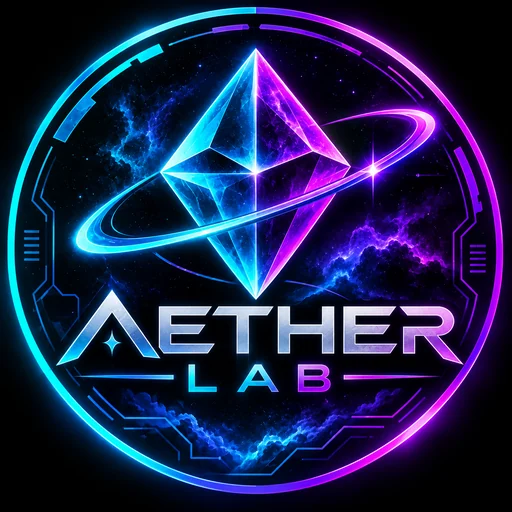
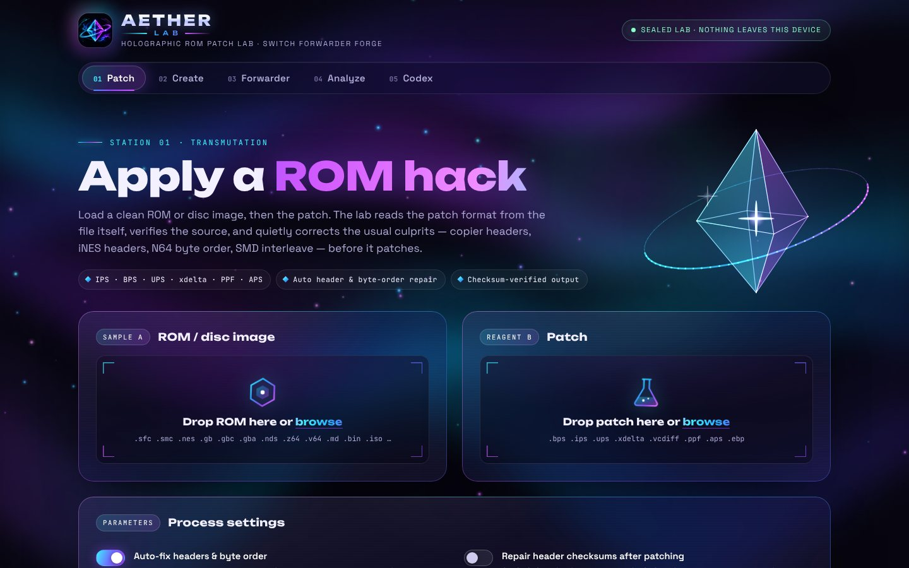
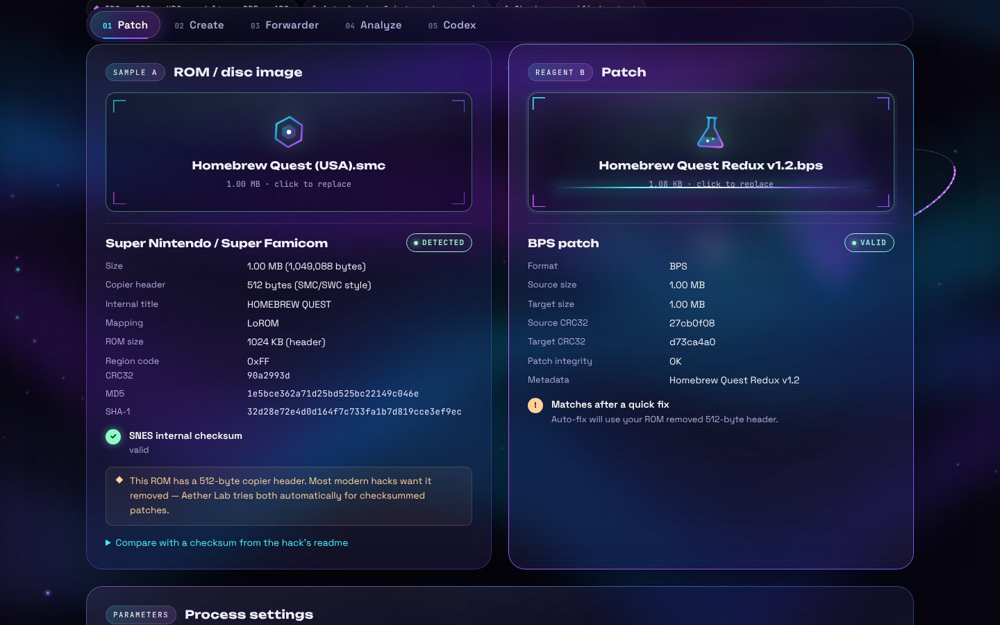
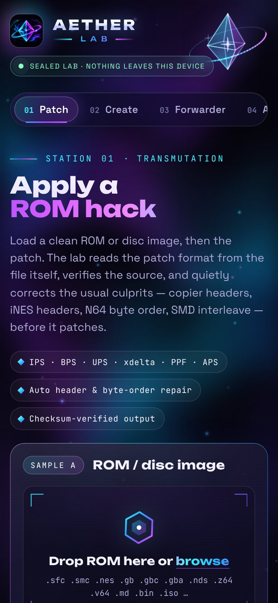
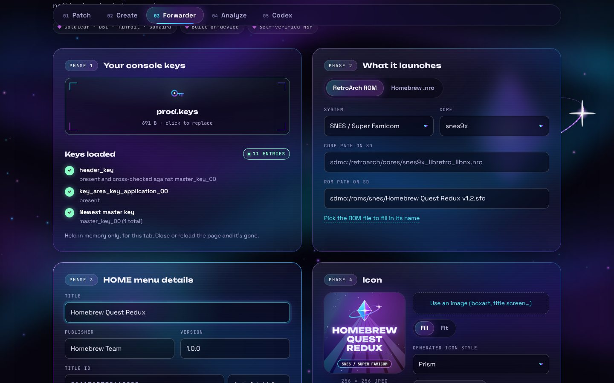

<div align="center">



# Aether Lab

**A holographic ROM-hack lab that runs entirely in your browser.**
Apply and create patches for every major console, fix headers and checksums, and forge
Nintendo Switch NSP forwarders — with nothing uploaded, ever.

[](https://github.com/AsyuTheAnonymous/Aether-Lab/actions/workflows/ci.yml)
[](LICENSE)


**Try it:** [full edition](https://asyutheanonymous.github.io/Aether-Lab/) · [patcher edition at aether.silvea.tech](https://aether.silvea.tech)

<!--
  Deploy on Hostinger button (Hostinger open-source partner program).
  Replace YOUR_PARTNER_CODE with the code from hPanel, then delete the two comment lines around it.
[](https://www.hostinger.com/deploy?template=AsyuTheAnonymous/Aether-Lab&ref=YOUR_PARTNER_CODE)
-->



</div>

---

## What's inside

Aether Lab is five "stations" on one static page:

| Station | What it does |
| --- | --- |
| **01 · Patch** | Applies **IPS, IPS32, EBP, BPS, UPS, xdelta (VCDIFF), PPF v1–3 and APS (N64 & GBA)**. Verifies the source ROM, then quietly fixes the usual reasons patches fail — SNES copier headers, iNES headers, N64 byte order, SMD interleave — and can repair header checksums afterwards. |
| **02 · Create** | Builds **BPS, UPS or IPS** patches from an original and a modified ROM. Every patch is test-applied before you can download it. |
| **03 · Forwarder** | Forges **installable NSP forwarders** for a homebrewed Switch: a HOME-menu icon that launches a ROM straight into its RetroArch core, or any homebrew `.nro`. Install with Goldleaf, DBI, Tinfoil or sphaira. |
| **04 · Analyze** | Identifies 20+ systems from their headers, shows CRC32 / MD5 / SHA-1, checks header checksums, strips or adds headers and converts N64 byte order. |
| **05 · Codex** | A built-in troubleshooting guide. |

<table>
  <tr>
    <td width="62%"></td>
    <td width="38%"></td>
  </tr>
</table>

### Why another patcher?

- **Private by construction.** The page's Content Security Policy is `connect-src 'none'`: the browser itself refuses every network request, so ROMs, patches and console keys *can't* be uploaded — not by a bug, not by a compromised script.
- **It fixes the boring failures for you.** Checksummed patches (BPS, UPS, xdelta, APS) say exactly which ROM they want. Aether Lab tries the header and byte-order variants of your ROM until one matches, and tells you what it changed.
- **Forwarders without a PC toolchain.** No hacBrewPack download, no Python, no Windows-only GUI — the NSP is built in the browser tab with your own `prod.keys`.
- **No build step, no dependencies.** Plain HTML, CSS and JavaScript. Open `index.html` from disk and it works.

## Quick start

**Use it locally** — download the repo (green **Code** button → *Download ZIP*), unzip, and open `index.html` in Chrome, Edge, Firefox or Safari. That's it.

**Or run the bundled server** (Node.js 20+):

```bash
npm start            # http://localhost:3000
```

**Deploy it** — it's a static site, so any web host works. Step-by-step guides for Hostinger (static or Node.js), GitHub Pages and others are in [docs/getting-started.md](docs/getting-started.md).

### Two editions

| Edition | Stations | Get it from |
| --- | --- | --- |
| **Full** | All five | This repository (`main`), no build |
| **Patcher** | Patch, Create, Analyze, Codex: no Switch forwarder | The [`patcher-site`](https://github.com/AsyuTheAnonymous/Aether-Lab/tree/patcher-site) branch, rebuilt automatically from `main` |

Use the patcher edition if you'd rather keep Switch tooling off a particular server. See [getting-started](docs/getting-started.md#two-editions).

## Supported formats

| Format | Apply | Create | Verifies source | Notes |
| --- | :---: | :---: | :---: | --- |
| **BPS** | ✓ | ✓ | CRC32 | Recommended for sharing hacks. Handles moved/inserted data. |
| **UPS** | ✓ | ✓ | CRC32 | Reversible — feed it the patched ROM to get the original back. |
| **IPS / IPS32 / EBP** | ✓ | ✓ (IPS) | — | No checksums. IPS is limited to 16 MB. |
| **xdelta3 / VCDIFF** | ✓ | — | Adler-32 per window | Patches made with secondary compression (`-S lzma/djw/fgk`) are detected and explained, not decoded. |
| **PPF v1 / v2 / v3** | ✓ | — | Disc block check, image size | PS1/PS2 disc images. |
| **APS (N64)** | ✓ | — | Cart ID + header CRC | Byte order converted automatically. |
| **APS (GBA)** | ✓ | — | CRC16 per 64 KB block | |

RUP, BSDiff and Star Rod patches are recognised and reported as unsupported.

## Supported systems

Header detection and info for NES · Famicom Disk System · SNES · Game Boy · Game Boy Color · Game Boy Advance · Nintendo 64 · Nintendo DS · 3DS · Mega Drive / Genesis · 32X · Sega CD · Saturn · Master System · Game Gear · GameCube · Wii · PlayStation 1/2 · PSP · Atari 7800 · Atari Lynx · PC Engine.

Checksum repair for GB/GBC (header + global), GBA (complement), SNES (internal, with mirroring), Mega Drive, N64 (boot CRC for CIC 6101/6102/6103/6105/6106) and Nintendo DS (header CRC16).

## Switch forwarders



You need a Switch running **Atmosphère with up-to-date signature patches**, and `prod.keys` from **your own console**. The forwarder points at `sdmc:/retroarch/cores/<core>_libretro_libnx.nro` with your ROM's SD path (or at any homebrew `.nro`), and its title ID is derived the same way sphaira does it — so rebuilding a forwarder updates it instead of creating a duplicate.

Everything — requirements, title IDs, icons, installing with Goldleaf and troubleshooting — is in [docs/forwarders.md](docs/forwarders.md).

## Documentation

| Guide | For |
| --- | --- |
| [Getting started](docs/getting-started.md) | Running locally and deploying (Hostinger, GitHub Pages, any host) |
| [Patching](docs/patching.md) | Applying patches, headers, checksums, troubleshooting |
| [Creating patches](docs/creating-patches.md) | Sharing your own hack |
| [Forwarders](docs/forwarders.md) | Building and installing NSP forwarders |
| [Analyze](docs/analyze.md) | The ROM tools station |
| [Architecture](docs/architecture.md) | How the code is organised; adding formats, consoles and cores |
| [NSP format notes](docs/nsp-format.md) | How the forwarder NSP is put together, byte by byte |
| [Design system](docs/design.md) | The holographic look, effects engine and performance rules |
| [Testing](docs/testing.md) | The test suite and its cross-tool fixtures |

## Project layout

```
index.html          the whole app (five stations)
css/                fonts.css, style.css — design tokens live in :root
js/core/            byte helpers and hashes (CRC32, MD5, SHA-1, SHA-256, Adler-32)
js/patch/           one file per patch format + engine.js (auto-fix logic)
js/rom/             console detection, headers, checksums, N64 helpers
js/nsp/             AES, prod.keys, PFS0/RomFS/IVFC, NCA, NACP/NPDM/CNMT, forwarder builder
js/ui/              one file per station, DOM helpers, icon generator, fx.js (visual effects)
fonts/ images/      self-hosted fonts; the logo, header mark, favicons and app icons
manifest.webmanifest  name and icons for "Add to Home Screen"
licenses/           licence texts for the fonts and the forwarder ExeFS
tests/              dependency-free test suite + fixtures made by other tools
tools/              build-patcher.js: makes the patcher edition (no Switch forwarder)
docs/               the guides above
server.js           optional zero-dependency static server (npm start)
.htaccess           security headers for Apache / LiteSpeed (Hostinger)
_headers            the same headers for Netlify / Cloudflare Pages
.github/            CI, the patcher-edition publisher, issue and pull request templates
.nojekyll           tells GitHub Pages to serve the files as they are
```

## Contributing

Bug reports, new patch formats, console support and core presets are all welcome — see [CONTRIBUTING.md](CONTRIBUTING.md). Please never attach ROMs, disc images or keys to issues or pull requests.

Found a security problem? Please report it privately — see [SECURITY.md](SECURITY.md).

## Credits

- Forwarder ExeFS: [nx-hbloader](https://github.com/switchbrew/nx-hbloader) (ISC) with the Forwarder-Mod patches, as built by [TooTallNate/switch-nsp-forwarder](https://github.com/TooTallNate/switch-nsp-forwarder).
- NSP layout follows [hacBrewPack](https://github.com/The-4n/hacBrewPack); title-ID scheme follows [sphaira](https://github.com/ITotalJustice/sphaira).
- Fonts: Unbounded, Space Grotesk and JetBrains Mono (SIL Open Font License).
- Patch fixtures were generated with xdelta3, python-bps and [RomPatcher.js](https://github.com/marcrobledo/RomPatcher.js) to keep us honest.

Full notices: [THIRD_PARTY_NOTICES.md](THIRD_PARTY_NOTICES.md).

## License and disclaimer

Aether Lab is released under the [MIT License](LICENSE). Built by Ashton Geer / [Silvea Technologies](https://silvea.tech).

Aether Lab contains no ROMs, BIOS files, keys or other copyrighted game data, and isn't affiliated with Nintendo, Sega, Sony or any game publisher. Use it with games and keys you own.
